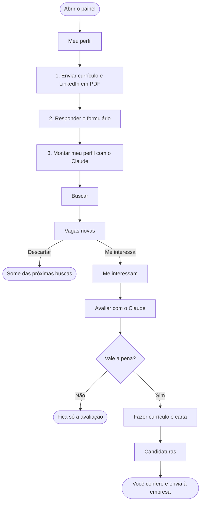

# O painel: a busca de emprego em botões

O painel é uma página que roda **só no seu computador** e faz o caminho inteiro do projeto com
botões: montar o perfil, buscar vagas, separar as que interessam, avaliar cada uma e gerar
currículo e carta. Nada aqui exige escrever comandos. Quando quiser acompanhar e corrigir
junto, cada etapa também tem o caminho pela conversa com o Claude.

Este guia mostra o fluxo inteiro, aba por aba. A parte técnica (onde cada coisa é gravada, o
que roda por trás, permissões) está no fim. Para o caminho completo com um exemplo, incluindo o
que vem depois do painel (revisar, enviar, acompanhar, entrevista), veja o
[TUTORIAL.md](TUTORIAL.md).

---

## O fluxo inteiro



| Etapa | Aba | Quem faz | Quanto tempo |
|---|---|---|---|
| Montar o perfil | Meu perfil | O Claude, uma vez (e quando você atualizar o currículo) | alguns minutos |
| Buscar vagas | Buscar | O painel, sem o Claude | 1 a 3 minutos |
| Separar as vagas | Vagas novas | Você | o quanto quiser |
| Avaliar uma vaga | Me interessam | O Claude | 2 a 3 minutos |
| Fazer currículo e carta | Me interessam | O Claude | até meia hora |
| Acompanhar | Candidaturas | O painel | - |
| Enviar a candidatura | - | **Você**, no site da empresa | - |

**O painel nunca envia nada a empresa nenhuma.** Quem se candidata é você, com os arquivos
que ele preparou.

---

## Abrir e fechar

- **Windows:** abra a pasta do projeto no Explorador de Arquivos e dê **dois cliques em
  `abrir-painel.bat`**.
- **Mac ou Linux:** no terminal, na pasta do projeto, rode `python3 tools/painel.py`.

Abre uma janela preta (o terminal) e o navegador com o painel. **A janela preta é o painel:
deixe aberta**, pode minimizar. Para fechar o painel, feche essa janela.

Se o navegador não abrir sozinho, copie o endereço que aparece na janela preta
(`http://127.0.0.1:8765/`) e cole no navegador. Esse endereço só funciona no seu computador.

Enquanto o seu perfil não existe, o painel abre direto na aba **Meu perfil**.

---

## 1. Meu perfil

O ponto de partida. O perfil é o que a busca, a avaliação e o currículo usam para saber quem
você é e o que você procura.

**Aviso de privacidade (no topo).** O perfil vai para arquivos do projeto que o git publica.
O painel confere para onde o projeto está ligado:

| O que aparece | O que quer dizer |
|---|---|
| 🔒 Seu repositório no GitHub é privado | Tudo certo: só você vê |
| 🔒 Não está ligado a nenhum repositório on-line | Tudo certo: fica só no computador |
| ⚠ Repositório público | Qualquer pessoa veria o perfil depois de um envio (push). O painel pede confirmação antes de montar |
| ⚠ Não consegui conferir | Mesmo cuidado: o painel pede confirmação |

**Passo 1: seus documentos.**
- **Enviar currículo (PDF):** o seu currículo mais completo.
- **Enviar LinkedIn (PDF):** opcional. No LinkedIn: seu perfil > Mais > Salvar como PDF.
- Só aceita PDF, até 10 MB. Currículo em Word? Abra no Word e use Arquivo > Salvar como > PDF.
- Antes de enviar, se quiser, tire do currículo CPF, RG e data de nascimento: nada aqui precisa deles.
- Enviou o arquivo errado? Clique em **Remover** ao lado dele.

**Passo 2: o que o currículo não diz.** Um formulário em quatro blocos. Tudo é opcional, mas
cada resposta deixa a busca e a avaliação mais certeiras:

| Bloco | Perguntas | Para que serve |
|---|---|---|
| Quem é você | cidade, gênero gramatical dos textos, idiomas e nível, situação atual | Currículo e carta no gênero certo; vagas que exigem um idioma que você não lista são descartadas |
| O trabalho que você busca | cargos, níveis (júnior, pleno, sênior...), setores, competências, empresas, motivação | Montar as buscas e julgar o encaixe |
| Condições | modelo (remoto, híbrido, presencial), cidades aceitas, regimes (CLT, PJ...), pretensão, deal-breakers | Descartar o que você não aceita e comparar CLT com PJ |
| Opcional | idioma do currículo, perfil comportamental | O tom das cartas e o encaixe de cultura |

Clique em **Salvar respostas**.

**Passo 3: montar o perfil.** O botão **Montar meu perfil com o Claude** (ou **Atualizar meu
perfil**, se você já tem um) chama o Claude, que lê os documentos e as respostas e grava o
perfil. Quando o formulário e o currículo discordam, vale o formulário.

No fim, aparece **"O que o Claude fez na última montagem"**:
- o que foi gravado em cada arquivo;
- **os conflitos** com o perfil que já existia: ele mantém o que estava gravado e mostra o que o
  documento novo diz, para você decidir;
- **o que foi inferido**: o que ele deduziu sozinho, sem você ter dito. Confira com atenção;
- **as lacunas**: o que nem o currículo nem o formulário cobrem. Ele não inventa.

Logo abaixo, **"Seu perfil como está agora"** mostra o perfil gravado.

> Pela conversa: escreva `/setup` no Claude. Ele faz as mesmas perguntas uma a uma e mostra os
> conflitos para você decidir na hora.

---

## 2. Buscar

Roda as buscas do seu perfil nos portais instalados (Gupy, Sólides, VAGAS.com, LinkedIn e
outros). **Não usa o Claude**, então não gasta o seu plano.

- **Prioridades:** as buscas vêm agrupadas por prioridade (montadas pelo perfil). As
  prioridades 1 e 2 vêm marcadas.
- **Publicadas nos últimos:** 7, 14 ou 30 dias.
- **Buscar vagas:** leva de 1 a 3 minutos; dá para continuar usando o computador.

No fim, aparece um resumo por portal e o link **Ver as vagas novas**. As vagas que você já
viu (marcadas aqui, no `/scrape` ou que já estão em Candidaturas) não voltam.

> Pela conversa: `/scrape` faz a mesma busca e já comenta o encaixe de cada vaga.

---

## 3. Vagas novas

A lista do que a busca encontrou e você ainda não separou.

**Filtros:** texto (cargo ou empresa), modelo de trabalho, portal e **só sem avisos**.

**Cada cartão mostra:** cargo, empresa, local, modelo, nível, regime, salário (quando o
anúncio informa), data de publicação e em que portais a vaga apareceu. Um **⚠ aviso** aparece
quando o texto da vaga contradiz o rótulo do portal ou traz algo que pesa:
- "remoto" no portal, mas híbrido ou presencial no texto;
- seleção interna (só para quem já é da empresa) ou vaga exclusiva para um grupo;
- vaga de intermediário (consultoria contratando para terceiros);
- nível fora dos que você marcou no perfil;
- portais que discordam do modelo de trabalho.

Vale o texto da vaga, não o rótulo. Um aviso não descarta a vaga: só chama a sua atenção.

**Botões:**
- **Ver vaga** e, quando existe, **Vaga completa na empresa** (o anúncio original, quando o
  portal mostra só um resumo).
- **Me interessa:** guarda a vaga em **Me interessam**.
- **Descartar:** tira a vaga da lista.

As duas escolhas ficam gravadas: a vaga some desta lista e das próximas buscas.

---

## 4. Me interessam

As vagas que você guardou. Cada uma tem três botões.

**Avaliar com o Claude** (2 a 3 minutos). O Claude lê a vaga e compara com o seu perfil. A
avaliação aparece no cartão:
- **Integridade da vaga:** um filtro procura texto escondido ou suspeito no anúncio. Quando ele
  não roda, a avaliação diz isso no topo, em vez de dar um veredito no olho.
- **Origem:** se o link é de um portal conhecido ou de um site de recrutamento reconhecido.
- **Notas** de competências, experiência, encaixe de cultura e carreira, a **nota geral** e o
  **veredito** (de Strong Fit a Poor Fit).
- **Regime e salário:** a referência salarial só aparece com a página consultada, com o link.
  Sem fonte, a avaliação diz "não consultada", nunca um número de memória.
- **Pontos fortes, lacunas e recomendação.**

**Fazer currículo e carta** (até meia hora). Só fica ativo depois da avaliação. O Claude:
1. escreve o currículo e a carta para a vaga, a partir do seu perfil;
2. chama um segundo agente que pesquisa a empresa e critica os rascunhos, e revisa;
3. gera os PDFs e confere: currículo com exatamente 2 páginas, carta com 1, nada cortado;
4. confere o currículo como um sistema de recrutamento (ATS) o lê;
5. registra a candidatura em **Candidaturas**, como rascunho.

O relatório aparece no cartão: o checklist de verificação, as principais escolhas e as
lacunas tratadas. Os arquivos ficam nas pastas `cv` (currículo) e `cover_letters` (carta),
em `.tex` e `.pdf`.

**Pelo painel, o Claude não pode perguntar nada.** Então ele para e avisa, em vez de decidir
por você, quando:
- o filtro de integridade acusa algo na vaga, ou a origem do link não é verificada;
- o formulário da candidatura pede respostas (os campos da Gupy, por exemplo): isso fica para a
  conversa;
- você usa um modelo próprio de currículo (`/add-template`): a compilação fica para a conversa.

**Confira sempre o currículo e a carta antes de enviar.**

**Copiar pedido:** copia `/apply <link da vaga>` para você colar na conversa com o Claude, no
VS Code, e fazer tudo isso acompanhando e corrigindo junto.

O Claude trabalha **numa coisa por vez**: enquanto ele avalia ou escreve, os outros botões do
Claude ficam desligados, e uma linha mostra o que ele está fazendo e desde quando.

---

## 5. Candidaturas

A tabela das suas candidaturas (`job_search_tracker.csv`): data, empresa, cargo, situação e
nota de encaixe. As situações:

| No painel | Quer dizer |
|---|---|
| Rascunho | Currículo e carta prontos, ainda não enviados |
| Enviada | Você se candidatou |
| Entrevista | Em processo |
| Proposta / Contratação | Chegou lá |
| Não seguiu / Sem resposta / Desisti / Proposta recusada | Encerrada |

Para mudar a situação depois de enviar, escreva na conversa com o Claude
`/outcome <empresa>`. Para se preparar para uma entrevista marcada, `/interview`.

---

## Quando algo não funciona

| O que acontece | O que fazer |
|---|---|
| A página não abre | A janela preta precisa estar aberta. Abra o `abrir-painel.bat` de novo e cole `http://127.0.0.1:8765/` no navegador |
| "não consegui abrir a porta 8765" | Outro painel já está aberto: use aquele, ou feche a outra janela preta |
| "Não achei o Claude Code neste computador" | Os botões do Claude dependem do Claude Code instalado (Passo 4 do [COMECE-AQUI.md](COMECE-AQUI.md)). A busca funciona sem ele |
| "O Claude não terminou: ..." | A mensagem diz o motivo. Tente de novo; se repetir, faça pela conversa (botão **Copiar pedido**) |
| "o Claude já está trabalhando em outro pedido" | Espere o pedido atual terminar: a linha de status mostra o que ele está fazendo |
| "Ainda não há buscas no seu perfil" | Monte o perfil na aba **Meu perfil** (ou `/setup` na conversa) |
| A avaliação abre com "⚠ O filtro de integridade não rodou" | Não confie no veredito de segurança dessa avaliação: rode de novo ou avalie pela conversa |
| O botão "Montar meu perfil" está desligado | Falta enviar o currículo, ou marcar a confirmação de privacidade |

---

## Por dentro (para quem quer saber)

### O que roda

`tools/painel.py` é um servidor pequeno que só escuta em `127.0.0.1`. A página
(`tools/painel/index.html`) mostra tudo o que vem de vagas e do Claude como texto, nunca como
HTML. Cada pedido que grava algo leva um código gerado a cada abertura do painel, e pedidos
vindos de outro endereço são recusados.

| Botão | O que roda por trás |
|---|---|
| Buscar vagas | `tools/scrape_run.py search` (as CLIs dos portais), sem o Claude |
| Me interessa / Descartar | grava em `job_scraper/seen_jobs.json` |
| Montar meu perfil | `claude -p`: o Caminho A do `/setup`, com o formulário no lugar das perguntas |
| Avaliar com o Claude | `claude -p`: os Passos 0 e 1 do `/apply` |
| Fazer currículo e carta | `claude -p`: os Passos 2 a 6b do `/apply`, a partir da avaliação gravada |

O `claude -p` é o Claude Code sem conversa, com o login do seu computador: não há chave de API
nem servidor externo. O pedido vai pela entrada padrão, nunca na linha de comando.

### Onde cada coisa fica

| O quê | Onde | No git? |
|---|---|---|
| Currículo e LinkedIn enviados | `documents/cv/`, `documents/linkedin/` | Não |
| Respostas do formulário | `documents/perfil/respostas.json` | Não |
| Perfil montado | `CLAUDE.md`, `.claude/skills/job-application-assistant/0*.md`, `.claude/skills/job-scraper/search-queries.md`, `cv/main_example.tex` | **Sim** (por isso o aviso de privacidade) |
| Resultado da busca | pasta temporária do sistema (`painel_busca_<data>.json`) | Não |
| Vagas vistas e separadas | `job_scraper/seen_jobs.json` | Não |
| Avaliações e relatórios do Claude | `documents/applications/_painel/` | Não |
| Currículo e carta gerados | `cv/main_<empresa>_<cargo>.tex/.pdf`, `cover_letters/cover_<empresa>_<cargo>.tex/.pdf` | Não |
| Vaga arquivada | `documents/applications/<empresa>_<cargo>/job_posting.md` | Não |
| Candidaturas | `job_search_tracker.csv` | Não |

### O que o Claude do painel pode fazer

Sem ninguém para aprovar, o Claude chamado pelo painel tem as permissões do projeto mais as de
um arquivo próprio para cada botão. O que não estiver liberado é negado.

| Botão | Arquivo | Pode |
|---|---|---|
| Avaliar / Fazer currículo e carta | `tools/painel/claude-settings.json` | ler; pesquisar na web; gravar só o currículo, a carta, a pesquisa de empresas, `documents/applications/` e o tracker; compilar só pelo `tools/compile_doc.py`, que desliga a execução de comandos pelo LaTeX |
| Montar meu perfil | `tools/painel/claude-settings-perfil.json` | ler; gravar só os arquivos de perfil. **Sem web e sem shell**: o currículo é lido, nunca buscado, e nada sai do computador |

O `tools/security_guards.py` confere esses arquivos em todo PR. O [SECURITY.md](SECURITY.md)
tem o modelo de ameaças completo.

### Opções

```bash
python3 tools/painel.py              # porta 8765, abre o navegador
python3 tools/painel.py --port 0     # qualquer porta livre
python3 tools/painel.py --no-browser # sem abrir o navegador
```
